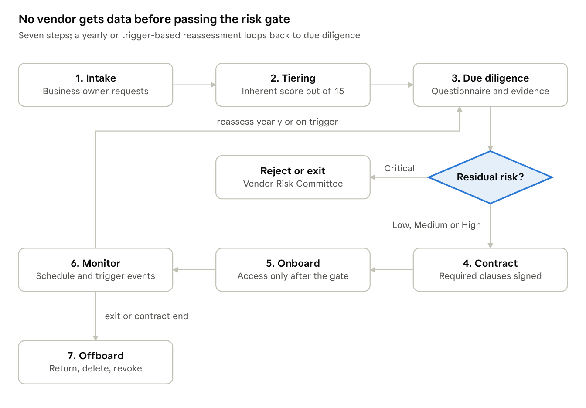

# Third-Party Risk Management Programme: Suvidha Finserv

*Suvidha Finserv Ltd (fictional NBFC) · Portfolio project · Khooshi Joshi · November 2026*

## Contents

1. [Purpose, scope and programme overview](#1-purpose-scope-and-programme-overview)
2. [Vendor inventory](#2-vendor-inventory)
3. [Vendor tiering](#3-vendor-tiering)
4. [Vendor lifecycle](#4-vendor-lifecycle)
5. [Due diligence questionnaire](#5-due-diligence-questionnaire)
6. [Risk scoring model](#6-risk-scoring-model)
7. [Contract requirements](#7-contract-requirements)
8. [Ongoing monitoring and offboarding](#8-ongoing-monitoring-and-offboarding)
9. [Vendor risk register](#9-vendor-risk-register)
10. [Worked example: bank-statement analysis vendor (V03)](#10-worked-example-bank-statement-analysis-vendor-v03)
11. [Governance, roles and KPIs](#11-governance-roles-and-kpis)
12. [Regulatory and control mapping](#12-regulatory-and-control-mapping)
13. [Assumptions, disclaimer and sources](#13-assumptions-disclaimer-and-sources)

---

## 1. Purpose, scope and programme overview

Suvidha relies on 10 key vendors that hold customer KYC, bank statements and loan data; this programme rates each one, sets the checks and contract terms it must meet, and keeps watching it until the relationship ends.

**Why Suvidha needs it**

- **Accountability stays with Suvidha.** Under the DPDP Act, a Data Fiduciary remains responsible for personal data even when a Data Processor handles it, and may engage a processor only under a valid contract.
- **RBI expects outsourcing oversight.** An NBFC must manage the risks of outsourced IT and financial services, keep audit and access rights, and stay able to meet its own regulatory duties.
- **Vendors cause breaches.** In the companion breach playbook and DPIA, the two highest residual risks both run through vendors: the eKYC storage bucket and the bank-statement analysis vendor.

**Scope**

| In scope | Out of scope |
| --- | --- |
| Every third party that stores, processes or can access Suvidha personal data or critical systems | One-off purchases with no data or system access (stationery, catering) |
| IT and cloud providers, SaaS tools, data vendors, collection agencies, call centres, payment partners | Intra-group companies (covered by group policy) |
| Fourth parties (sub-processors) of Tier 1 and Tier 2 vendors | Customers and regulators |

**Programme in one line per step**

1. **Inventory:** know every vendor and what it touches (Section 2).
2. **Tier:** rate inherent risk before any review (Section 3).
3. **Assess:** send a questionnaire sized to the tier and check evidence (Sections 5 and 6).
4. **Contract:** include the mandatory clauses for that tier (Section 7).
5. **Monitor:** reassess on a schedule and on trigger events (Section 8).
6. **Record:** keep every result in the vendor risk register (Section 9).
7. **Govern:** escalate, report and improve (Section 11).

**Policy rule:** no vendor gets access to Suvidha data or systems until it has a tier, a completed assessment for that tier, and a signed contract with the required clauses.

## 2. Vendor inventory

Suvidha's 10 key vendors split into 6 that hold customer personal data at scale, 2 regulated data partners, and 2 with narrower access; vendor names are generic because the company is fictional.

| ID | Vendor (type) | Service | Data or access | Records | Business critical? |
| --- | --- | --- | --- | --- | --- |
| V01 | Public cloud provider | Hosts the lending app, loan system and data stores (Mumbai region) | All customer and loan data; infrastructure | ~12 lakh customers | Yes |
| V02 | eKYC and video-KYC vendor | Identity verification at onboarding | KYC documents, masked Aadhaar, photos, video-KYC recordings | ~3 lakh a year | Yes |
| V03 | Bank-statement analysis vendor | Extracts credit features from bank statements | Raw bank statements and transaction text | ~3 lakh a year | Yes |
| V04 | Account Aggregator (RBI-regulated) | Consent-based sharing of bank data | Financial data, only as consented | ~1.5 lakh a year | Yes |
| V05 | Credit bureau (regulated) | Credit reports and repayment reporting | Identity and repayment history | All borrowers | Yes |
| V06 | Payment gateway and NACH partner bank | Disbursement and EMI collection | Bank account, mandate, payment data | All borrowers | Yes |
| V07 | Collection agencies (3 firms) | Field and phone recovery | Defaulters' contact details, dues, visit notes | ~40,000 accounts | No |
| V08 | Call-centre vendor | Customer support and outbound calls | Contact details, call recordings, ticket history | ~2 lakh contacts a year | No |
| V09 | SMS and email gateway | OTPs, alerts and statements | Mobile numbers, emails, message content | All customers | Yes (OTPs) |
| V10 | HR and payroll SaaS | Payroll and HR records | Employee ID, bank details, salary | ~900 employees | No |

**Sub-processors (fourth parties) to track**

- V02 uses a separate cloud host and a face-match software provider.
- V03 runs on its own cloud account and uses an OCR tool.
- V07 agencies use individual field agents and their own dialler software.

Each Tier 1 and Tier 2 vendor must list its sub-processors and tell Suvidha before adding a new one.

## 3. Vendor tiering

Each vendor gets an inherent risk score out of 15 before any review, which places 4 of Suvidha's vendors in Tier 1, 5 in Tier 2 and 1 in Tier 3; the tier decides how deep every later step goes.

**Inherent risk criteria (0 to 3 points each)**

| Criterion | 0 | 1 | 2 | 3 |
| --- | --- | --- | --- | --- |
| Data sensitivity | No personal data | Internal business data | Contact details | KYC, financial or bank data |
| Volume of people | Under 1,000 | 1,000 to 1 lakh | 1 lakh to 10 lakh | Over 10 lakh |
| Business criticality | No impact if it fails | Minor delay | Significant disruption | Lending stops |
| Access | None | Limited or pseudonymised data | Stores or processes identifiable copies | Hosts or directly accesses Suvidha systems |
| Regulatory weight | Not a regulated activity | Supports a regulated activity | Performs part of a regulated activity | Core regulated function (KYC, payments, recovery) |

**Tiers**

| Tier | Score | Meaning |
| --- | --- | --- |
| Tier 1, Critical | 12 to 15 | Failure or breach would stop lending or expose large volumes of KYC or financial data |
| Tier 2, High | 8 to 11 | Holds significant personal data or supports a regulated activity |
| Tier 3, Medium | 4 to 7 | Limited personal data or limited impact |
| Tier 4, Low | 0 to 3 | No personal data and no system access |

**Override:** any vendor holding KYC or financial data of more than 1 lakh people is at least Tier 2, whatever its score.

**Suvidha's vendors scored**

| ID | Vendor | Data | Volume | Criticality | Access | Regulatory | Score | Tier |
| --- | --- | --- | --- | --- | --- | --- | --- | --- |
| V01 | Public cloud provider | 3 | 3 | 3 | 3 | 3 | 15 | **Tier 1** |
| V02 | eKYC and video-KYC vendor | 3 | 2 | 3 | 2 | 3 | 13 | **Tier 1** |
| V06 | Payment gateway and NACH bank | 3 | 3 | 3 | 2 | 2 | 13 | **Tier 1** |
| V03 | Bank-statement analysis vendor | 3 | 2 | 3 | 2 | 2 | 12 | **Tier 1** |
| V05 | Credit bureau | 3 | 3 | 2 | 2 | 1 | 11 | Tier 2 |
| V09 | SMS and email gateway | 2 | 3 | 3 | 2 | 1 | 11 | Tier 2 |
| V07 | Collection agencies | 3 | 1 | 1 | 2 | 3 | 10 | Tier 2 |
| V04 | Account Aggregator | 3 | 2 | 2 | 1 | 1 | 9 | Tier 2 |
| V08 | Call-centre vendor | 2 | 2 | 1 | 3 | 1 | 9 | Tier 2 |
| V10 | HR and payroll SaaS | 3 | 0 | 1 | 2 | 0 | 6 | Tier 3 |

**What each tier requires**

| Requirement | Tier 1 | Tier 2 | Tier 3 | Tier 4 |
| --- | --- | --- | --- | --- |
| Questionnaire | Full (all 8 domains) | Full | Short (core questions) | None; declaration only |
| Evidence | Certificates, audit reports, pen test, policies | Certificates or audit reports, key policies | Certificate or self-attestation | None |
| On-site or virtual audit | Yearly | Every 2 years, or on trigger | On trigger | No |
| Full reassessment | Yearly | Every 2 years | Every 3 years | At renewal |
| Approver | Vendor Risk Committee | CISO and DPO | Vendor Manager | Business owner |

## 4. Vendor lifecycle

Every vendor passes through seven steps, and the residual risk gate after due diligence decides whether it can be contracted at all.

A Critical result means rejection or exit. A High result can pass only with Chief Risk Officer approval and a 90-day remediation plan (Section 6), and monitoring sends every vendor back to due diligence on its reassessment date or when a trigger event happens (Section 8).

## 5. Due diligence questionnaire

The questionnaire has 32 questions across 8 domains, each asking for evidence rather than a yes or no; Tier 1 and 2 vendors answer all of them, and Tier 3 vendors answer the 12 core questions marked ★.

| # | Domain | Question | Evidence expected |
| --- | --- | --- | --- |
| 1.1 ★ | Governance | Do you hold ISO/IEC 27001 certification, a SOC 2 Type II report, or both? What is in scope? | Certificate with scope statement; latest SOC 2 report |
| 1.2 | Governance | Who is accountable for information security and privacy, and how often does your board review them? | Org chart; board minutes extract |
| 1.3 | Governance | When were your security policies last reviewed and approved? | Policy list with review dates |
| 1.4 | Governance | Do staff with access to client data get security and privacy training every year? | Training records and completion rate |
| 2.1 ★ | Data protection | Exactly which Suvidha personal data will you process, for what purpose, and for how long? | Data flow and retention statement |
| 2.2 ★ | Data protection | Will you process Suvidha data only on Suvidha's documented instructions and never for your own purposes, including model training? | Signed declaration; DPA draft |
| 2.3 | Data protection | How do you support Suvidha in answering access, correction and erasure requests? | Process description and timelines |
| 2.4 | Data protection | How and when do you delete or return data at the end of processing and at contract end? | Deletion procedure; sample deletion certificate |
| 3.1 ★ | Access control | Is MFA enforced for all access to systems holding Suvidha data? | Configuration screenshot or policy |
| 3.2 | Access control | How are privileged accounts controlled and monitored? | PAM tool evidence; review records |
| 3.3 | Access control | How often are user access rights reviewed, and how fast is a leaver's access removed? | Last two quarterly review records |
| 3.4 | Access control | Can any of your staff see Suvidha data in clear text? Who, and why? | Role list with justification |
| 4.1 ★ | Data security | Is Suvidha data encrypted at rest and in transit? Which standards, and who manages the keys? | Encryption standard; key management procedure |
| 4.2 ★ | Data security | Where is Suvidha data stored and processed, including backups and logs? Does any of it leave India? | Data location statement by system |
| 4.3 | Data security | When was your last independent penetration test, and are critical findings fixed? | Pen test summary and remediation status |
| 4.4 | Data security | How do you patch and harden systems, and what is your patch time for critical issues? | Vulnerability management policy; metrics |
| 5.1 ★ | Incident response | How quickly will you notify Suvidha of a suspected breach affecting its data? | Commitment in writing (target: within 2 hours) |
| 5.2 | Incident response | Do you have a tested incident response plan? When was it last tested? | IR plan; last exercise report |
| 5.3 ★ | Incident response | Do you keep logs for at least 180 days and will you share them for an investigation? | Logging policy; retention setting |
| 5.4 | Incident response | Have you had a security incident or personal data breach in the last 3 years? What happened? | Incident summary and lessons learned |
| 6.1 ★ | Resilience | What are your recovery time and recovery point objectives for the service Suvidha uses? | BCP and DR plan with RTO and RPO |
| 6.2 | Resilience | When did you last test disaster recovery, and did you meet your RTO? | DR test report |
| 6.3 | Resilience | Do you have a single point of failure in staff, site or supplier? | Dependency assessment |
| 6.4 | Resilience | How would Suvidha get its data back and move to another provider if you stopped trading? | Exit and transition plan |
| 7.1 ★ | Sub-processors | List every sub-processor that will touch Suvidha data, with location and purpose. | Sub-processor register |
| 7.2 | Sub-processors | Do your sub-processor contracts carry the same security and privacy terms as ours? | Template clauses |
| 7.3 | Sub-processors | Will you tell Suvidha before adding or changing a sub-processor? | Written commitment and notice period |
| 7.4 | Sub-processors | How do you assess your own vendors' security? | Your TPRM procedure |
| 8.1 ★ | Regulatory | Will you allow Suvidha, its auditors and RBI to audit and inspect your operations for this service? | Signed audit-rights clause |
| 8.2 | Regulatory | Are you aware of, and able to support, CERT-In 6-hour reporting and RBI cyber incident reporting? | Process description |
| 8.3 ★ | Regulatory | If your service uses AI or automated decisions, how do you test it for accuracy and bias? | Model documentation; test results |
| 8.4 | Regulatory | Have you faced any regulatory action, penalty or litigation about data or security in the last 3 years? | Declaration |

**How answers are checked**

- Every answer needs evidence; "yes" without evidence scores as "not in place".
- Certificates are checked for **scope** (does it cover the service Suvidha uses?) and **validity date**.
- For Tier 1, the assessor verifies at least 5 answers in a live session or audit.

## 6. Risk scoring model

Residual risk combines the vendor's tier with how strong its controls proved to be, and four red flags force a High rating no matter how good the rest of the answers are.

**Step 1: score each answer**

| Score | Meaning |
| --- | --- |
| 2 | In place, with evidence that covers Suvidha's service |
| 1 | Partly in place, or evidence is weak, out of scope or out of date |
| 0 | Not in place, or no evidence given |

**Step 2: weight the domains (total 100)**

| Domain | Weight |
| --- | --- |
| Data protection | 15 |
| Access control | 15 |
| Data security | 15 |
| Incident response | 15 |
| Governance | 10 |
| Resilience | 10 |
| Sub-processors | 10 |
| Regulatory | 10 |

Domain score = points earned ÷ points possible × weight. The control score is the sum of the 8 domain scores, out of 100.

**Step 3: rate control strength**

| Control score | Strength |
| --- | --- |
| 80 to 100 | Strong |
| 60 to 79 | Adequate |
| 40 to 59 | Weak |
| Below 40 | Poor |

**Step 4: read off residual risk (tier × control strength)**

| Tier | Strong | Adequate | Weak | Poor |
| --- | --- | --- | --- | --- |
| Tier 1 | Medium | High | Critical | Critical |
| Tier 2 | Low | Medium | High | Critical |
| Tier 3 | Low | Low | Medium | High |
| Tier 4 | Low | Low | Low | Medium |

**Red flags: any one makes residual risk at least High**

1. No written commitment to notify Suvidha of a breach within 2 hours.
2. Suvidha data stored or processed outside India without Suvidha's approval.
3. Refuses audit and inspection rights for Suvidha, its auditors or RBI.
4. Uses Suvidha data for its own purposes, including training its own AI models.

**Step 5: decide**

| Residual risk | Decision | Who approves |
| --- | --- | --- |
| Low | Approve | Per tier (Section 3) |
| Medium | Approve with a remediation plan and dates | CISO and DPO |
| High | Approve only with a time-bound remediation plan (90 days) and documented risk acceptance | Chief Risk Officer |
| Critical | Reject, or exit the existing relationship | Vendor Risk Committee |

## 7. Contract requirements

Every vendor that touches personal data signs a data processing agreement, and Tier 1 and 2 contracts must also carry breach-notice, audit, data-location and exit clauses before any data flows.

| Clause | What it says | Tier 1 | Tier 2 | Tier 3 |
| --- | --- | --- | --- | --- |
| Data processing agreement | Process only on Suvidha's documented instructions, for the stated purpose only | Required | Required | Required |
| No secondary use | No use of Suvidha data for the vendor's own purposes, analytics or AI model training | Required | Required | Required |
| Security standards | Maintain ISO 27001-aligned controls; encryption at rest and in transit; MFA | Required | Required | Required |
| Breach notification | Tell Suvidha within **2 hours** of discovering a suspected breach, with facts as known; full report within 24 hours | Required | Required | Within 24 hours |
| Data location | Store and process Suvidha data only in India unless Suvidha approves in writing | Required | Required | Required |
| Audit and inspection | Suvidha, its auditors and RBI may audit, inspect and access records | Required | Required | On request |
| Sub-processors | List all sub-processors; prior written notice before changes; same terms flow down | Required | Required | List only |
| Log retention | Keep logs for at least 180 days and share them for investigations | Required | Required | Not required |
| Rights support | Help Suvidha answer access, correction and erasure requests within set timelines | Required | Required | Required |
| Deletion and return | Delete or return all data at end of processing and contract; give a deletion certificate | Required | Required | Required |
| Business continuity | Maintain and test BCP and DR plans with agreed RTO and RPO | Required | Required | Not required |
| Exit and transition | Support transfer to a new provider; no data held hostage | Required | Required | Not required |
| Service levels | Measurable SLAs with penalties | Required | Required | Optional |
| Liability and indemnity | Cover for breach costs, regulatory penalties and customer claims caused by the vendor | Required | Required | Standard terms |
| Termination rights | Suvidha may terminate for material breach, regulatory direction or repeated SLA failure | Required | Required | Required |
| Conduct (collections only) | Follow RBI fair practices for recovery agents; no harassment; recorded calls | Required for V07 | | |

**Rule:** Legal may not remove or weaken a Required clause without written approval from the DPO and CISO, recorded in the vendor file.

## 8. Ongoing monitoring and offboarding

A vendor's rating is only as good as its last check, so Tier 1 vendors are watched continuously and reassessed every year, and seven trigger events force an early review for any tier.

**Monitoring schedule**

| Activity | Tier 1 | Tier 2 | Tier 3 |
| --- | --- | --- | --- |
| Certificate and audit report expiry check | Quarterly | Every 6 months | Yearly |
| SLA and performance review | Monthly | Quarterly | Yearly |
| External signals (news, breach reports, security ratings, financial health) | Continuous | Monthly | Quarterly |
| Remediation plan follow-up | Monthly until closed | Quarterly until closed | At reassessment |
| Full reassessment | Yearly | Every 2 years | Every 3 years |
| Audit (on-site or virtual) | Yearly | Every 2 years or on trigger | On trigger |

**Trigger events: start an early review**

1. The vendor reports, or the news reveals, a breach or major incident.
2. The vendor changes ownership, merges or shows financial distress.
3. A new sub-processor, new data location, or a move of data outside India.
4. Suvidha sends new types or much larger volumes of data.
5. A certificate lapses or an audit report shows a qualified opinion.
6. Repeated SLA failures or customer complaints traced to the vendor.
7. A regulatory change that affects the service (for example new RBI or DPDP rules).

**Offboarding checklist**

- [ ] Exit plan triggered and replacement vendor in place
- [ ] All Suvidha data returned in an agreed format
- [ ] Vendor and sub-processor copies deleted, with a signed deletion certificate
- [ ] All accounts, API keys, VPN and system access revoked within 24 hours of exit
- [ ] Final invoices and open issues closed
- [ ] Vendor marked "Exited" in the register, with the exit date and lessons learned

## 9. Vendor risk register

Three vendors carry High residual risk today, all conditionally approved with remediation plans: the bank-statement analysis vendor, the eKYC vendor and the collection agencies.

| ID | Vendor | Tier | Control score | Strength | Residual risk | Red flags | Status | Main open issue | Next review | Owner |
| --- | --- | --- | --- | --- | --- | --- | --- | --- | --- | --- |
| V03 | Bank-statement analysis vendor | 1 | 63 | Adequate | **High** | 1, 2, 4 | Conditionally approved | Pre-conditions in Section 10 | Feb 2027 | Chief Risk Officer |
| V02 | eKYC and video-KYC vendor | 1 | 72 | Adequate | **High** | None | Conditionally approved | Storage bucket made public during migration; no automated public-access block | Jan 2027 | Head of Lending Ops |
| V07 | Collection agencies | 2 | 55 | Weak | **High** | None | Conditionally approved | Field agents use personal phones; complaints about call timing | Jan 2027 | Head of Collections |
| V01 | Public cloud provider | 1 | 88 | Strong | Medium | None | Approved | Shared-responsibility settings must be checked by Suvidha | Mar 2027 | CISO |
| V06 | Payment gateway and NACH bank | 1 | 82 | Strong | Medium | None | Approved | None | Apr 2027 | Head of Operations |
| V09 | SMS and email gateway | 2 | 71 | Adequate | Medium | None | Approved with remediation | OTP messages logged in clear text for 30 days | Mar 2027 | Head of Digital |
| V08 | Call-centre vendor | 2 | 68 | Adequate | Medium | None | Approved with remediation | Agents can see full PAN on screen | Feb 2027 | Head of Customer Service |
| V05 | Credit bureau | 2 | 84 | Strong | Low | None | Approved | None | Nov 2028 | Head of Operations |
| V04 | Account Aggregator | 2 | 86 | Strong | Low | None | Approved | None | Nov 2028 | Head of Digital |
| V10 | HR and payroll SaaS | 3 | Pending | Pending | Pending | Pending | Under assessment | Short questionnaire sent | Dec 2026 | CHRO |

**Summary**

| Residual risk | Vendors |
| --- | --- |
| High | 3 (V03, V02, V07) |
| Medium | 4 (V01, V06, V09, V08) |
| Low | 2 (V05, V04) |
| Pending | 1 (V10) |

All scores and findings are fictional and illustrate how the register is kept.

## 10. Worked example: bank-statement analysis vendor (V03)

V03 scored 63 out of 100 (Adequate) and raised three red flags, so its residual risk is **High**: it is approved only on condition that all three red flags are fixed before any data flows and the remaining gaps within 90 days.

**Profile**

| Item | Detail |
| --- | --- |
| Service | Extracts credit features (income, EMIs, bounces) from applicants' bank statements |
| Tier | Tier 1 (inherent score 12) |
| Data | Raw bank statements and transaction text of ~3 lakh applicants a year |
| Assessment type | Full questionnaire, evidence review, virtual audit |

**Domain results**

| Domain | Points (of 8) | Weight | Weighted score | Key finding |
| --- | --- | --- | --- | --- |
| Data security | 6 | 15 | 11.3 | Strong encryption and recent pen test; **backups held in a Singapore cloud region** |
| Access control | 5 | 15 | 9.4 | MFA in place; privileged access not logged centrally |
| Data protection | 4 | 15 | 7.5 | **Standard terms let the vendor use "anonymised" client data to improve its models** |
| Incident response | 4 | 15 | 7.5 | **Offers 24-hour breach notice, not 2 hours**; logs kept only 90 days |
| Governance | 6 | 10 | 7.5 | ISO 27001 certified, but the OCR sub-processor is outside scope |
| Regulatory | 6 | 10 | 7.5 | Accepts audit rights; no bias testing of its feature model |
| Resilience | 5 | 10 | 6.3 | DR tested but RTO missed by 2 hours last year |
| Sub-processors | 5 | 10 | 6.3 | OCR tool provider not fully assessed by V03 |
| **Total** | | **100** | **63 (Adequate)** | |

**Red flags raised**

- **Red flag 1:** no 2-hour breach notice (only 24 hours).
- **Red flag 2:** backups stored outside India.
- **Red flag 4:** data used to improve the vendor's own models.

**Residual risk:** Tier 1 × Adequate = **High** (red flags also force at least High).

**Remediation plan**

| # | Action | Owner | Deadline | Condition |
| --- | --- | --- | --- | --- |
| 1 | Contract bans any use of Suvidha data for the vendor's models, anonymised or not | Legal | Before go-live | **Pre-condition: no data flows until signed** |
| 2 | Move backups to an India region and confirm in writing | Vendor; verified by CISO | Before go-live | **Pre-condition** |
| 3 | Breach notice cut from 24 hours to 2 hours in the contract | Legal | Before go-live | **Pre-condition** |
| 4 | Extend log retention from 90 to 180 days | Vendor | 30 days | Tracked monthly |
| 5 | Central logging and review of privileged access | Vendor | 60 days | Evidence required |
| 6 | Bring the OCR sub-processor into ISO 27001 scope or assess it | Vendor | 90 days | Evidence required |
| 7 | Delete Suvidha data within 24 hours of analysis, with monthly deletion reports | Vendor | 30 days | Matches DPIA mitigation M6 |

**Decision:** conditionally approved by the Chief Risk Officer. Once actions 1 to 7 are closed and verified, the expected control score is about 85 (Strong), which brings residual risk down to **Medium**, the lowest possible for a Tier 1 vendor.

## 11. Governance, roles and KPIs

The business owner of each vendor owns its risk, the Vendor Manager runs the programme, and a monthly Vendor Risk Committee makes every Tier 1 and High-risk decision.

**Roles**

| Role | Responsibility |
| --- | --- |
| Business owner | Requests the vendor; owns the vendor's risk; makes sure remediation happens |
| Vendor Manager (TPRM lead) | Runs tiering, questionnaires, register and monitoring; chases evidence and deadlines |
| CISO | Reviews security answers and evidence; leads audits of Tier 1 vendors |
| DPO | Reviews privacy answers, DPAs and sub-processors; checks alignment with the ROPA and DPIAs |
| Legal | Negotiates contracts; protects the Required clauses |
| Procurement | Blocks purchase orders until the vendor has a tier, an assessment and a signed contract |
| Chief Risk Officer | Accepts High residual risk; chairs the Vendor Risk Committee |
| Internal Audit (3rd line) | Tests that the programme works as designed, yearly |

**Vendor Risk Committee**

- Meets monthly; members are the CRO (chair), CISO, DPO, Head of Legal, Head of Procurement and business owners as needed.
- Approves all Tier 1 vendors, every High residual risk, and every exception to a Required clause.
- Reports quarterly to the Board Risk Management Committee.

**Escalation**

| Situation | Escalate to | Within |
| --- | --- | --- |
| Vendor misses a remediation deadline | CISO and DPO | 5 business days |
| Vendor misses a second deadline, or a pre-condition is unmet | Chief Risk Officer | 2 business days |
| Vendor breach affecting Suvidha data | Breach Response Lead (playbook) | Immediately |
| Residual risk becomes Critical | Vendor Risk Committee; plan exit | 2 business days |

**KPIs reported every quarter**

| KPI | Target |
| --- | --- |
| Vendors with a current tier and assessment | 100% |
| Tier 1 and 2 contracts with all Required clauses | 100% |
| Vendors onboarded without a completed assessment | 0 |
| Overdue reassessments | 0 |
| Remediation actions closed on time | At least 90% |
| Vendors with High or Critical residual risk | Falling quarter on quarter |
| Average time to complete a Tier 1 assessment | Under 30 days |
| Vendor-caused incidents and breaches | Tracked; each reviewed by the committee |

## 12. Regulatory and control mapping

The programme meets RBI's 2025 outsourcing directions for NBFCs, the DPDP processor rules and CERT-In timelines, and maps to ISO 27001 supplier controls and the NIST CSF 2.0 supply chain category.

**Key regulatory requirements**

- **RBI outsourcing directions (2025, consolidated):** RBI has brought outsourcing of financial services and of IT services into one set of directions for NBFCs. Contracts must be legally vetted and include detailed scope and service levels, unrestricted audit and access rights for the NBFC, direct inspection rights for RBI, strict subcontracting controls, confidentiality and security duties, BCP and DR, and orderly exit. The IT services chapter applies to NBFCs in the Middle Layer and above, which Suvidha is assumed to be.
- **DPDP Act:** Suvidha stays accountable for personal data its processors handle, and may engage a processor only under a valid contract (Section 8). Breaches at a processor still count as Suvidha's breach for reporting.
- **CERT-In Directions:** 6-hour incident reporting and 180-day log retention apply to Suvidha, so vendors must notify fast and keep logs.
- **RBI Digital Lending Directions 2025:** lending service providers and their apps must collect only need-based data with consent and store it in India.

| Programme element | RBI outsourcing directions | DPDP Act / Rules | ISO/IEC 27001:2022 | NIST CSF 2.0 |
| --- | --- | --- | --- | --- |
| Vendor inventory (Section 2) | Inventory of outsourced services | Sec 8 accountability | A.5.19 Supplier relationships policy | GV.SC-04 Suppliers known and prioritised |
| Tiering (Section 3) | Materiality assessment | Risk-based safeguards (Rule 6) | A.5.19 | GV.SC-04 |
| Due diligence (Sections 5 and 6) | Service provider evaluation | Sec 8(2) valid contract; Sec 8(5) safeguards | A.5.19; A.5.21 ICT supply chain | GV.SC-06 Due diligence before entering relationships |
| Contract clauses (Section 7) | Mandatory agreement clauses; audit and RBI inspection rights | Processor contract; breach support (Rule 7) | A.5.20 Security in supplier agreements | GV.SC-05 Requirements in contracts |
| Cloud vendor (V01) | IT outsourcing chapter | Data location in India (RBI) | A.5.23 Security for cloud services | GV.SC-05 |
| Monitoring (Section 8) | Monitoring and control of outsourced activities | Ongoing accountability | A.5.22 Monitoring and review of supplier services | GV.SC-07 Risks monitored during the relationship |
| Breach notice and logs | Incident reporting by service provider | Rule 7 breach intimation | A.5.24 to A.5.26 Incident management; A.8.15 Logging | GV.SC-08 Suppliers in incident planning |
| Offboarding (Section 8) | Termination and exit | Erasure at end of purpose (Sec 8(7)) | A.5.20; A.8.10 Information deletion | GV.SC-10 Provisions after the relationship ends |
| Governance (Section 11) | Board-approved outsourcing policy; board oversight | DPO oversight (SDF) | A.5.2 Roles; A.5.4 Management responsibilities | GV.SC-01, GV.SC-02 Programme and roles |

## 13. Assumptions, disclaimer and sources

Suvidha Finserv Ltd, its vendors, scores and findings are fictional; this is a portfolio piece, not legal advice.

- Suvidha is assumed to be an NBFC in the Middle Layer, so the IT outsourcing chapter of RBI's directions applies, and a Significant Data Fiduciary under DPDP.
- Vendor names are generic on purpose; no real company is assessed.
- Scoring weights, thresholds and review frequencies are illustrative design choices.
- RBI directions and DPDP Rules should be checked for the latest version and commencement dates before real use.
- This programme is the third part of a series for the same fictional company, with the [Personal Data Breach Response Playbook](https://github.com/khooshijoshi30/dpdp-breach-response-playbook) and the [ROPA & DPIA](https://github.com/khooshijoshi30/dpdp-ropa-dpia-assessment).

**Sources**

- [RBI Outsourcing Directions 2025 for NBFCs (KS&K)](https://ksandk.com/corporate/rbi-outsourcing-directions-2025/)
- [IT outsourcing under the consolidated directions (Vinod Kothari)](https://vinodkothari.com/tag/it-outsourcing/)
- [RBI Master Direction on IT outsourcing (JSA)](https://www.mondaq.com/india/it-and-internet/1311402/rbi-master-direction-on-it-outsourcing-by-regulated-entities)
- [RBI Digital Lending Directions 2025 overview](https://www.mondaq.com/india/financial-services/1628380/reserve-bank-of-india-digital-lending-directions-2025)
- [NIST Cybersecurity Framework 2.0](https://www.nist.gov/cyberframework)
