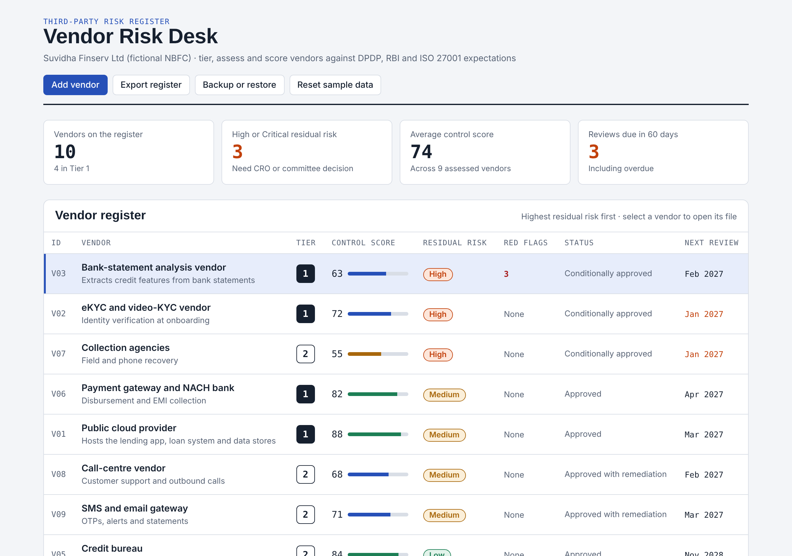
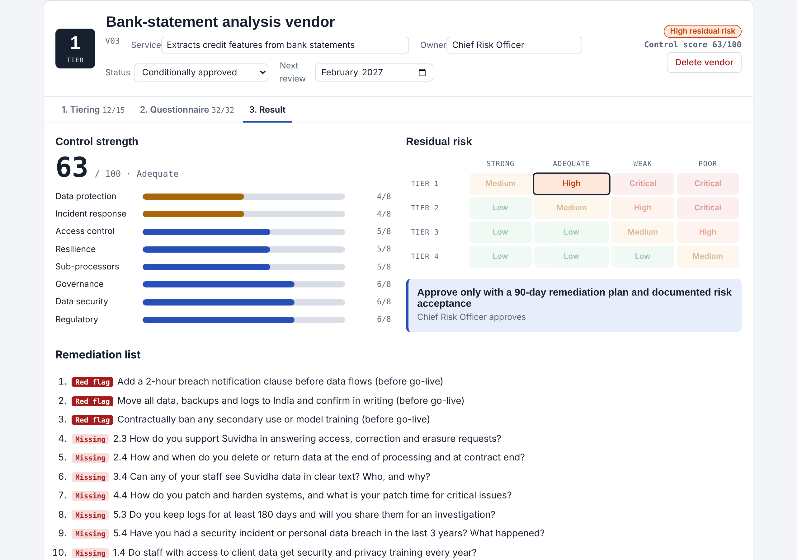
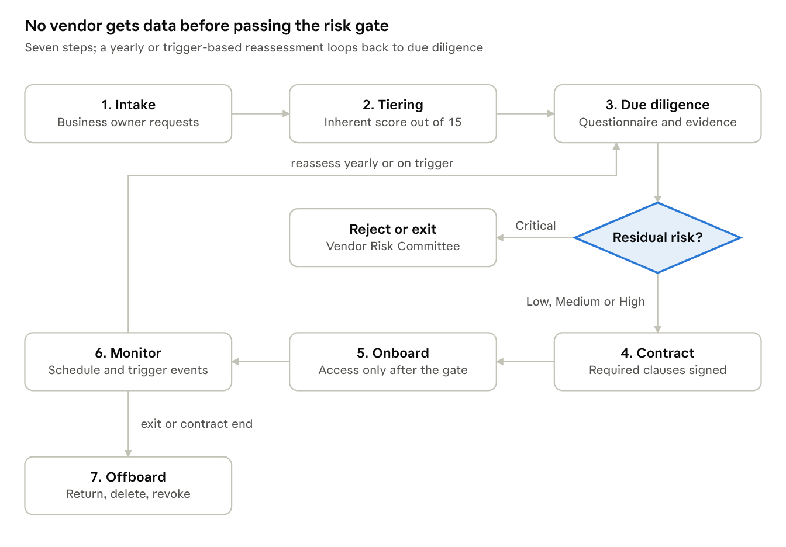

<h1 align="center">Vendor Risk Desk</h1>

<p align="center">
  <b>A third-party risk management programme and a working vendor risk scoring tool for an Indian NBFC</b><br>
  RBI Outsourcing Directions 2025 · DPDP Act 2023 · CERT-In · ISO/IEC 27001:2022 · NIST CSF 2.0
</p>

<p align="center">
  <a href="https://khooshijoshi30.github.io/vendor-risk-desk/"><b>▶ Open the live tool</b></a> ·
  <a href="PROGRAMME.md"><b>Read the programme</b></a>
</p>

<p align="center">
  
  
  
  
  
</p>

---

## 📌 At a glance

| | |
| --- | --- |
| **What** | A complete TPRM programme (policy and method) **plus** a working web tool that applies it automatically |
| **For** | *Suvidha Finserv Ltd*, a fictional RBI-registered NBFC with 10 key vendors |
| **Method** | 5-criteria tiering → 32-question evidence-based questionnaire → weighted control score → residual risk matrix → red-flag overrides |
| **Key finding** | 3 of 10 vendors carry High residual risk; the bank-statement vendor has 3 red flags that must be fixed before any data flows |
| **Tested** | The tool reproduces the manual worked example exactly (V03: score 63, Adequate, High) |

---

## 🖥️ The tool



**What it does**

- **Register** of all vendors, sorted by residual risk, with summary tiles for the committee
- **Tiering:** rate 5 inherent-risk criteria and the tier is calculated instantly (with the "over 1 lakh KYC records" override)
- **Questionnaire:** 32 questions across 8 weighted domains; Tier 3 vendors see only the 12 core questions
- **Result:** control score, domain breakdown, the residual risk cell highlighted in the matrix, the approval decision, and an **auto-generated remediation list**
- **Red flags** (no 2-hour breach notice, data outside India, no audit rights, secondary use) force at least High
- **Export** the register as CSV for Excel, **back up and restore** all data, **reset** to the sample vendors



**How it is built:** one self-contained `index.html` file (HTML, CSS and vanilla JavaScript), with no server, no build step and no external libraries apart from Google Fonts. Data is saved in the browser's localStorage.

---

## 📄 The programme



| # | Section | What it delivers |
| --- | --- | --- |
| 1 | Purpose & scope | Why vendors matter under DPDP and RBI; policy rule: no data before the risk gate |
| 2 | Vendor inventory | 10 vendors, the data they touch, volumes, criticality, sub-processors |
| 3 | **Tiering** | 5 criteria scored 0–3; 4 tiers with depth of review for each |
| 4 | **Lifecycle** | 7 steps with a residual risk gate (diagram above) |
| 5 | **Questionnaire** | 32 evidence-based questions across 8 domains |
| 6 | **Scoring model** | Weights, strength bands, tier × strength matrix, 4 red flags, decision rules |
| 7 | **Contract clauses** | 16 clauses by tier (2-hour breach notice, India data location, RBI audit rights…) |
| 8 | Monitoring & offboarding | Review schedule, 7 trigger events, offboarding checklist |
| 9 | Vendor risk register | All 10 vendors scored |
| 10 | **Worked example** | Full assessment of the bank-statement analysis vendor |
| 11 | Governance & KPIs | Roles, Vendor Risk Committee, escalation, 8 KPIs |
| 12 | **Control mapping** | RBI ↔ DPDP ↔ ISO 27001 (A.5.19–A.5.23) ↔ NIST CSF 2.0 (GV.SC) |

👉 [**Read PROGRAMME.md**](PROGRAMME.md)

---

## 🛠️ Skills demonstrated

- **Third-party risk management:** inherent vs residual risk, tiering, due diligence, contract controls, monitoring, offboarding
- **Regulation:** RBI Outsourcing Directions 2025, DPDP processor obligations, CERT-In, RBI Digital Lending Directions
- **Control frameworks:** ISO/IEC 27001:2022 supplier controls, NIST CSF 2.0 supply chain risk management
- **Risk quantification:** weighted scoring, risk matrices, override rules, decision thresholds
- **Building tools:** turning a written methodology into a tested, working web application

---

## 🔗 Related projects

Part of a series built for the same fictional company:

- [Personal Data Breach Response Playbook & Tabletop Kit](https://github.com/khooshijoshi30/dpdp-breach-response-playbook)
- [ROPA & DPIA: AI Credit Scoring at an Indian NBFC](https://github.com/khooshijoshi30/dpdp-ropa-dpia-assessment)

---

## 📂 Repository structure

```
vendor-risk-desk/
├── index.html          ← the working tool (open it in any browser)
├── PROGRAMME.md        ← the full TPRM programme
├── README.md           ← you are here
└── images/
    ├── register.png
    ├── vendor-result.png
    └── vendor-lifecycle.png
```

**Run it locally:** download `index.html` and open it in any browser. No installation needed.

---

## ⚠️ Disclaimer

*Suvidha Finserv Ltd*, its vendors, scores and findings are **fictional**. Vendor names are generic and no real company is assessed. This is a portfolio project, **not legal advice**. Regulatory references reflect public sources as of **November 2026**.

---

## 👩‍💻 About the author

**Khooshi Joshi**
